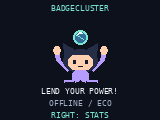

# BadgeCluster

BadgeCluster lends small bursts of badge processing power to a shared estimate of pi.

This build connects Universe 2026 badges to the live Azure service using verified HTTPS.
Open BadgeCluster from the menu. RIGHT opens Stats, LEFT returns to Mona,
and BACK/HOME exits. Both pages share one worker. Configure a reachable 2.4 GHz
Wi-Fi network using the badge's Settings app. An open network uses an empty
password. Credentials stay on the badge and are never sent to Azure.

The worker schedules 250 Monte Carlo samples every 60 seconds, at most 25
samples and a target 5 ms per frame. Missed intervals never accumulate.
Wi-Fi preparation starts on launch, with `JOINING WIFI` followed by
`WAITING SYNC` until the first batch is ready. The first sync is due after one
minute; healthy uploads then follow each completed batch, roughly every 60
seconds. Request duration does not add another delay to the next batch's upload.
Accepted samples increase only after Azure acknowledges them. This uses Wi-Fi
more frequently than the previous two-minute upload cycle, without increasing
the 250-samples-per-minute compute rate.
Without connectivity, pending samples remain local and retry with backoff.
Closing the app stops the worker. Counters live in RAM and reset on launch;
there are no per-sample flash writes, LEDs, background threads, or hardware identifiers.
A per-launch random seed comes from `os.urandom` on hardware. The simulator
uses explicitly labelled pseudorandom bytes and cannot send contributions.

## Persistent badge identity

On its first launch, the physical badge generates a random 128-bit node ID
and saves it atomically to `/state/badgecluster_identity.json`. Every subsequent
launch and reboot reuses that ID, including after app updates. Copying an app
does not copy its identity; never clone the state file to another badge.
The ID is pseudonymous, not derived from a serial number or MAC address.

Each launch still uses a fresh random session ID, so resetting RAM counters
cannot replay an old session's totals. Contributions carry the stable `nodeId`
and the per-launch `sessionId`; server-side per-node history can group those
sessions. Accepted/Pending on the badge remain **current-session** counters,
not lifetime totals. No service changes or server-issued registration are required.

Earlier builds created a new node ID on each launch. Those old IDs may remain
in the service's five-minute active window until they expire. Active is a
recent-contributor count, not the number of open Wi-Fi connections.
The local identity is written only once. Storage errors or a corrupt identity
stop startup explicitly rather than silently creating another badge ID; restore
the identity file to preserve attribution.

Battery percentage is intentionally omitted pending device calibration.
Eco mode is used regardless of USB power. The core has a tested battery policy
hook, but it is not connected to unverified firmware telemetry.

`cluster_core.py` also implements immutable cumulative contribution snapshots,
acknowledgement validation, stale status, and capped 30/60/120/300-second retry
backoff. The session controller drives the device adapter through cooperative
prepare/start/poll/cancel calls. Wi-Fi association happens ahead of the request;
time sync, DNS and HTTPS share a five-second end-to-end deadline. Failed requests
retain the exact snapshot for retry.
Failed uploads still use 30/60/120/300-second backoff, even when a new batch
finishes; the faster healthy cadence never bypasses that delay. Cached global
statistics become stale after two missed one-minute sync intervals.
Wi-Fi association has its own 15-second deadline. If the access point is missing,
authentication fails, or joining stalls, the app clears the failed radio state
and reports `NET: network`, then retries after 30/60/120/300 seconds rather than
remaining on `JOINING WIFI` indefinitely. Saved credentials and badge identity
are unchanged. Pending contributions survive these retries while the app stays open.
Association is driven directly through `network.WLAN` using the existing saved
Wi-Fi fields; this avoids the tested firmware helper's latched failure state.
The separate [BadgeCluster repository](https://github.com/dylan-mccarthy/BadgeCluster)
contains the Azure App Service coordinator. The supplied spec and development handoff are under `docs/badgecluster/`
at the repository root.

## Device networking

The endpoint is `https://badgecluster-37nlkk2a4ucny.azurewebsites.net/api/v1/contributions`.
The app reuses firmware `fetch.AsyncFetch` HTTP handling, but replaces its
blocking DNS and unverified TLS connection. DNS uses nonblocking UDP to the
network's configured resolver; TLS requires the bundled DigiCert Global Root G2
trust anchor and the Azure hostname. No plaintext HTTP or `CERT_NONE` fallback
is used. Responses are limited to 8 KiB and each HTTP line to 2 KiB.

On the first request each launch, the app sets the RTC using standard
**unauthenticated NTP** at `162.159.200.1:123` (Cloudflare). The network must allow
UDP 123, UDP DNS and outbound HTTPS. NTP validates the echoed request nonce and
server status; it is not an authenticated time source. Certificate expiry and
hostname checks remain enabled. Time sync failure leaves the app offline.
Wi-Fi association and cryptographic operations still depend on firmware timing;
worst-case per-frame network timing and live device acknowledgements need a
reachable access point to verify.

`NET: timeout`, `NET: network`, or `NET: invalid_response` on Stats indicates a
retryable failure; details are printed on USB serial without credentials.
BACK/HOME cancels pending sockets and stops computation and contributions.
The simulator exercises UI/offline behavior only.

On the tested firmware, the USB volume's `secrets.py` is
`/system/secrets.py`, but the runtime Wi-Fi module loads `/secrets.py` first.
If USB edits do not take effect, use Settings or synchronize only the two Wi-Fi
fields on-device; do not copy credentials into this repository.

## Live Azure test mode

From the repository root, install the host test dependency:

```sh
python -m pip install -r tools/requirements-badgecluster.txt
```

Then run:

```sh
python tools/test_badgecluster_azure.py --live --output /tmp/badgecluster-azure-test
```

This runs the **actual app code under CPython with a Pillow graphics adapter**
and real HTTPS to the live Azure coordinator. It is not a MicroPython or
hardware simulator. It contributes 250 genuinely computed samples with random
pseudonymous IDs, drops the first acknowledgement, retries the identical
snapshot, checks accepted-vs-pending counters and page navigation while HTTPS
is in flight, and verifies exit stops further work. Time is accelerated only
for scheduling, not sample computation. It writes screenshots and a JSON report.
Omit `--live` and the command refuses to submit anything. These host test samples
are included in the shared Azure totals. `--base-url` can select another HTTPS
coordinator. Do not use the host adapter on a physical badge.

The Azure test passed with 250 accepted samples and unchanged global totals
across the duplicate request. The UI serviced 198 frames during the two HTTPS
operations. See `docs/badgecluster/azure-testing.md` for the test scope and limits.

## Validation and next milestone

Run `python -m unittest discover -s tests -p 'test_badgecluster*.py'` and
`python .github/skills/hyb26-skill/scripts/validate_app.py badge/apps/badgecluster`.
See `docs/badgecluster/device-spike.md` for the remaining real-device checks.
Host-rendered previews below use a graphics test adapter, not real firmware.




Artwork is original geometric pixel art created for this project, under the
repository's MIT license. The energy sphere is illustrative, not telemetry.
