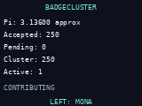
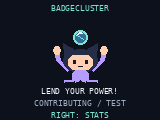
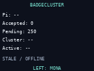

# BadgeCluster live Azure test mode

The live host test passes against
https://badgecluster-37nlkk2a4ucny.azurewebsites.net.

## What ran

`python tools/test_badgecluster_azure.py --live --output /workspace/badgecluster-test-results`

The harness executes the actual `badge/apps/badgecluster/__init__.py`, worker,
protocol and session controller under CPython, with a Pillow graphics/input
adapter and HTTPS performed in host-only subprocesses. The only networking
module in the deployable app returns `None` by default; the harness injects
its test adapter without changing that device default.

The test really computed 250 Monte Carlo samples, of which 196 were inside
the quarter circle, for this session's approximate pi of 3.136. It submitted
the counts with random anonymous node/session IDs. It deliberately discarded
the first successful server response and verified:

- Accepted count stayed zero while the response was lost; pending stayed 250.
- The retry used exactly the same sequence, samples, inside and IDs.
- Azure acknowledged 250 samples; global totals remained 250 across both
  requests, confirming the retry did not add the samples twice.
- The UI serviced 198 update frames during HTTPS, including LEFT/RIGHT input.
- The actual Stats screen displayed the acknowledged count, global pi and
  activity. Mona displayed `CONTRIBUTING / TEST`.
- Exit closed the worker/client/transport, and further updates could not compute
  or submit more work.

No points were fabricated. The schedule was accelerated to avoid a minute-long
wait. The resulting 250 accepted samples remain in the shared Azure totals.
Future runs use new random IDs and will contribute another 250 samples.

Committed evidence is in [screenshots](screenshots/) and the
[run summary](test-results/azure-host-2026-10-28.json). The full request/response
report is generated in the chosen output directory when rerunning the harness.
The report records request/response snapshots and whether global totals stayed
unchanged between retries. If other clients submit concurrently, global totals
may change; a stable per-session acknowledgement alone cannot establish why the
aggregate changed. The isolated server idempotency tests cover that case.

## Other checks

Twenty worker/protocol/session unit tests pass. They cover slice limits, tick
wrap, no catch-up bursts, pause thresholds, retries, bad acknowledgements,
independent compute during a request, five-second cancellation, offline default,
and exit during an active request. Static app and app README validators pass.
The ordinary offline host preview still passes.

## What this does not prove

This is not the MicroPython browser simulator or a physical badge test.
Fonts, device timing, battery readings, actual orientation, Wi-Fi, TLS CA trust,
DNS and socket behavior on the 2026 firmware remain unverified. The host's
subprocess adapter is intentionally outside the deployable app and is not a
proposed MicroPython implementation. Follow `device-spike.md` before enabling
real badge networking or installing this as a connected badge application.

## Screenshots from the real Azure test

These use the CPython/Pillow host adapter, not physical badge firmware.

